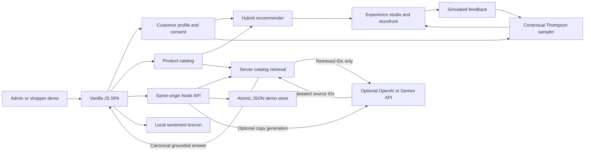
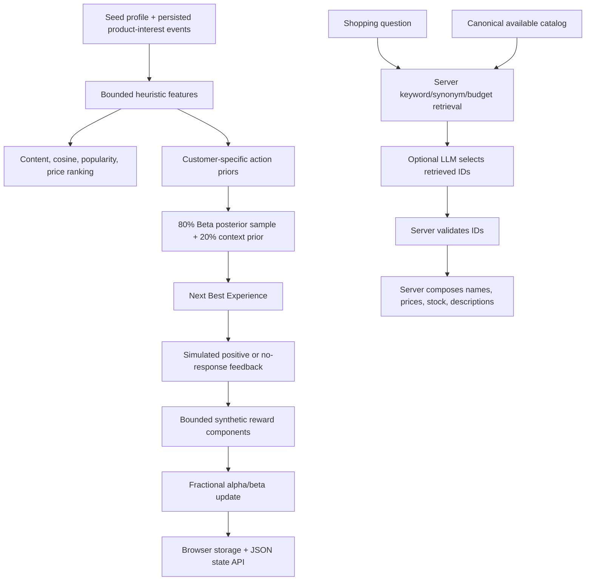

# AI system and decision methods

## System map

All customer profiles, catalog rows, co-purchase events, and feedback outcomes used by this demo are synthetic. The app contains deterministic algorithms and heuristics, plus optional server-side LLM calls. It contains no trained predictive model, model evaluation results, or measured commerce outcomes.

## Component reference

| Component | Purpose and input | Processing and output | App location | Type and fallback | Limitations |
|---|---|---|---|---|---|
| Hybrid recommendation | Rank in-stock catalog items for a profile; uses categories, style, purchase labels, AOV, seeded purchase IDs, and persisted catalog-interest events. | Weighted normalized score: 55% content fit, 25% item-item cosine, 12% popularity, 8% price fit. Returns ranked products, score factors, stock, and a short reason. For a profile with no history, collaborative weight moves to content (80%); popularity and price remain. | Customer 360, Experience studio, Live storefront. | Deterministic ranking algorithm; no LLM. Cold start uses content, popularity, and price. | The co-purchase matrix is a small synthetic seed; cosine similarity is a demo signal, not statistically validated collaborative filtering. Popularity uses seeded rating × stock. |
| Content-based product ranking | Match profile preferences to products; uses profile category, style, purchase labels, and product tags. | Counts tag/category matches and normalizes to a 0–1 preference-fit component. | Included in hybrid recommendation cards and scores. | Deterministic algorithm. If no preference match exists, content score can be low; other active ranking components still contribute. | Tag matching is simple lexical overlap, not embeddings or learned representations. |
| Synthetic co-purchase similarity | Use item relationships to enrich rankings when a customer has history. | Builds binary item vectors from synthetic co-purchase baskets and computes cosine similarity against known or persisted product-interest IDs. | Hybrid recommendation cards show the component only when history is present. | Deterministic cosine algorithm over synthetic data; omitted for no-history profiles. | Tiny, hand-authored matrix; no real cohort or trained collaborative model. |
| Customer intelligence scores | Summarize seeded behavioral signals. Inputs include view count, cart count, days since activity, engagement, order count, and discount reliance. | Intent = 8-point baseline + normalized views (20%) + carts (32%) + recency (20%) + engagement (20%). Churn = 8-point baseline + inactivity (42%) + low engagement (22%) + limited order history (18%) + discount reliance (10%). Sensitivity = 15-point baseline + 75% discount reliance. Scores are clamped to 0–100. Historical spend = seeded orders × AOV. | Customer 360, action eligibility, decision signals, CSV export. | Transparent heuristic baselines; no LLM and no trained ML. Missing/invalid numeric inputs are safely bounded. | Directional estimates only; not probabilities, validated predictions, or forward CLV. The seeded segment and engagement labels are observed demo attributes. |
| Next Best Experience action selection | Select a consent-eligible experience; inputs are the above profile features, order history, offer timing, and per-customer/action Beta state. | Every arm stores alpha, beta, and observation count. Eligibility enforces consent, context rules, and the local 14-day offer recommendation cap. The rank score blends an 80% Thompson sample from Beta(alpha,beta) with a 20% context prior. Output includes selected action, rationale, posterior mean, uncertainty, expected simulated reward, and a trade-off. | Experience studio and Optimization lab. | Contextualized Thompson-sampling decision algorithm with deterministic seeded PRNG for reproducible demos. “No action” remains eligible. | Priors are heuristic. This is a small demo bandit, not a production causal policy; no real exposure/outcome attribution exists. |
| Bandit reward | Update the selected action after positive or no-response feedback. | Bounded synthetic reward combines response (35%), engagement proxy (15%), revenue contribution proxy (15%), retention value (15%), customer experience (20%), and a 0.30 offer discount-cost penalty. Adds reward to alpha and `1 - reward` to beta. | Optimization lab feedback controls and simulated rounds. | Simulated reward proxy; no LLM. Missing commerce outcomes are represented by explicitly labeled simulated response. | Revenue and retention inputs are proxies based on synthetic profile values; reward is not conversion, revenue, or measured satisfaction. No discount is issued. |
| Catalog retrieval / RAG | Answer product questions using available catalog entries. Input is the question; the server ignores client-supplied facts. | Keyword/synonym matching plus budget parsing retrieves canonical in-stock rows. Unsupported questions produce an explicit no-match answer. With an LLM, only retrieved IDs may be selected; the server validates IDs and renders every product fact from its canonical catalog. | Shopping assistant. | Retrieval and final fact rendering are deterministic. Local grounded answer is used without credentials, on provider error, or when no match exists. Optional LLM can rerank retrieved IDs only. | Small vocabulary/synonym map; no vector database or embedding model. Retrieval quality is limited to this demo catalog. |
| OpenAI Responses API | Optional language-model assistance. | Server calls `POST /v1/responses` with the configured model. For shopping, model output is constrained to selecting retrieved IDs. For marketing, it generates a draft from a synthetic profile summary and canonical product facts. | Shopping assistant and Experience studio marketing draft. | Used when `OPENAI_API_KEY` is configured. Without a key or on provider error, Gemini (when configured) or deterministic local answers/templates remain available. Key is server-side. | API use may be billable; ChatGPT access does not automatically include API credits. Assistant facts are server-rendered; marketing copy remains a draft and requires review. LLM output is not evidence of business performance. |
| Gemini Developer API | Optional language-model assistance for users with a Gemini API key, including eligible limited free-tier access. | Server calls Gemini `generateContent`. For shopping, model output is constrained to selecting retrieved IDs. For marketing, it generates a draft from a synthetic profile summary and canonical product facts. | Shopping assistant and Experience studio marketing draft. | Used when only `GEMINI_API_KEY` is configured; OpenAI takes precedence if both are set. Without a key or on provider error, deterministic local answers/templates remain available. Key is server-side. | Free-tier model availability and quota depend on account eligibility; Google's free-tier content-use terms apply. Assistant facts are server-rendered; marketing copy remains a draft and requires review. LLM output is not evidence of business performance. |
| Sentiment analysis | Identify obvious positive/frustrated language in a message. | Local keyword lexicon counts positive and negative terms, then suggests neutral handling, acknowledgment, or human support. | Trust & governance. | Deterministic lexical heuristic; no LLM and no remote fallback. | Small English vocabulary; displayed confidence is uncalibrated. Sarcasm, context, multilingual text, and nuanced emotion are not reliably handled. Message is not stored or sent. |
| Marketing content generation | Draft a customer-aware message for a chosen product, channel, and goal. | Uses a server-validated demo customer and canonical available product. Optional LLM writes a draft; otherwise a local template uses supplied canonical facts. | Experience studio. | LLM when configured; deterministic local template otherwise. Draft provider is labeled and approval is required. | Copy may need factual, brand, and legal review. Nothing is sent or published. Customer consent is checked in the normal UI; production authorization must be enforced server-side. |
| Multi-agent orchestration | No multi-agent workflow is implemented. | No autonomous agents, handoffs, or agent framework are present. Features are separate functions and routes. | Not applicable. | Not implemented. | Do not describe this application as agentic. |

## Data and model provenance

The `customers.js` and `catalog.js` files are deterministic synthetic seed records. The co-purchase baskets are defined in `client.js`; analytics and bandit state are demo interactions written to browser storage and, in local mode, `data/demo-db.json`. On Vercel, server-side demo state is written to temporary `/tmp` storage and can disappear across cold starts or instances. Sentiment text bodies are not persisted. Shopping questions may be sent to the configured OpenAI or Gemini API for ID selection; marketing prompts contain the selected synthetic profile summary and product facts. Never enter sensitive real customer information in this demo.

## Production limitations

There is no trained predictive model, customer-level production event stream, validated collaborative model, real reward observation, federated learning, or external commerce integration. The project makes no measured accuracy, conversion, revenue, retention, or lift claims. Production use would require consented and tenant-isolated data, time-separated evaluation, calibration, privacy and retention controls, API authorization, and human approval workflows.
