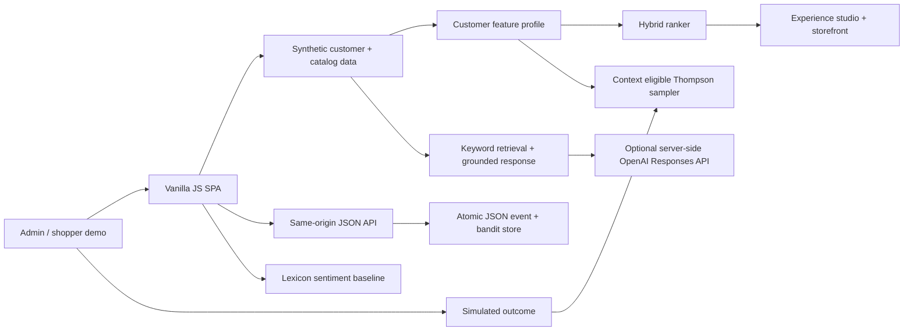

# Architecture

The MVP is a zero-dependency Node HTTP server plus a browser SPA. `app.js` contains the synthetic profile-driven recommendation ranker, action policy and UI rendering; `catalog.js` and `customers.js` provide canonical demo seeds. `server.js` exposes same-origin JSON APIs, server-side catalog retrieval, optional Responses API calls, and static assets. `store.js` persists bandit parameters and a bounded, validated interaction log in an atomic JSON file at `data/demo-db.json`. Browser local storage retains consent, selected profile, pending action, generated drafts and an offline event queue. The JSON store is for demo state and events, not a multi-tenant production database.

## Data flow

Profile fields represent synthetic aggregated purchase, browsing and campaign signals. The recommendation and decision engines consume that profile and saved catalog-interest history. Server retrieval filters canonical available products before an optional LLM chooses only among retrieved IDs; the server validates IDs and composes factual answers from catalog rows. Interaction events contain synthetic customer IDs and bounded metadata, never sentiment/chat message text. The LLM key remains server-side. Only synthetic demo state is persisted.

## Production extension

Replace the in-file stores with tenant-scoped APIs and a database; define authenticated catalog/event adapters; isolate organizations and consent; version model artifacts; add observability, retention policies, audit logs, and human approval workflows. External connectors are proposals only, not connected integrations.
