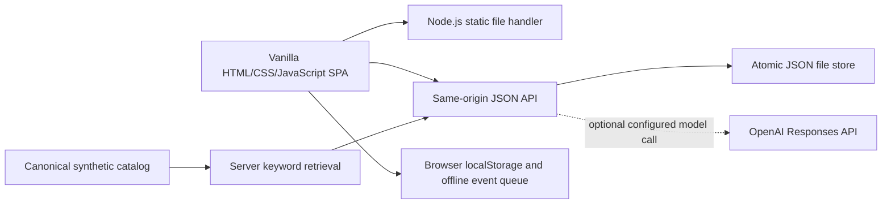

# Build provenance

## Application architecture

HyperPersonal is a single-process Node.js HTTP application serving a browser SPA and same-origin JSON routes. It has no frontend bundler, transpilation step, Python component, or third-party npm runtime dependency.



## Main technologies and responsibilities

| Component | Responsibility |
|---|---|
| `server.js` | Node built-in HTTP server, static allowlist, JSON routes, input validation, optional server-side OpenAI calls, canonical catalog retrieval. |
| `app.js` | Single-page UI rendering, customer scores, recommendations, contextual action policy, feedback/reward logic, local fallback interactions. |
| `customers.js`, `catalog.js` | Deterministic synthetic customer and product seed records shared by browser and server. |
| `store.js` | File-backed JSON persistence, event validation, bandit-state persistence, analytics summaries. |
| `analytics.js`, `index.html`, `styles.css` | Analytics rendering, SPA shell, responsive presentation. |
| `api.test.js`, `core.test.js` | Node built-in test-runner coverage for routes, persistence, algorithms, and the end-to-end demo flow. |

## Data sources and provenance

- Profiles and products are authored synthetic demo seeds in the repository, not imported customer or commerce data.
- Co-purchase baskets are synthetic examples in `app.js`; persisted product-interest events may augment a demo profile’s item history.
- Feedback and bandit reward values are simulated proxies. Dashboard journey charts/cohort values are illustrative.
- No production data source, partnership, external catalog integration, or measured business result is connected.
- Sentiment text is processed locally and is not logged. The event store records bounded metadata, not message bodies.

## AI services and algorithms

- Recommendation ranking: deterministic weighted content, synthetic item-item cosine, popularity, and price-fit scoring.
- Customer scores: transparent bounded heuristics; there is no trained prediction model.
- Next Best Experience: contextualized Beta-Bernoulli Thompson sampling with fractional, simulated reward updates.
- Shopping assistant: server-side keyword/synonym/budget retrieval and canonical fact rendering; optional LLM selects only among retrieved product IDs.
- Sentiment: local deterministic keyword lexicon.
- Marketing: optional OpenAI Responses API draft generation, with deterministic template fallback.
- Multi-agent orchestration and federated learning are not implemented.

See [AI_SYSTEM.md](AI_SYSTEM.md) for inputs, outputs, fallback behavior, and limitations per feature.

## Runtime and reproducible commands

- Minimum documented runtime: Node.js 18 or later. No Python runtime is required.
- Runtime dependencies: Node.js built-ins only. `package.json` has no dependency declarations; an npm lockfile is therefore not required.
- Environment: copy `.env.example` to `.env` only if enabling the optional server-side OpenAI integration. `OPENAI_API_KEY` is required for that path; `OPENAI_MODEL`, `PORT`, `HOST`, and `HYPERPERSONAL_DATA_FILE` are optional.
- Build: no compile/bundle step. The source JavaScript runs directly.

```sh
npm start
npm test
node --check app.js
node --check server.js
node --check store.js
```

The app listens on `http://127.0.0.1:4173` by default. It initializes `data/demo-db.json` on startup. The store is intended for a local demo, not concurrent or multi-tenant production use.

## Test and quality results

At preparation time, `npm test` reports **35 passing tests, 0 failures**. Coverage includes recommendation differences and cold start, persisted item-interest history, score bounds, bandit feedback/reward updates, contextual selection, retrieval/no-match handling, server validation and persistence, UI page rendering, and the demo workflow. Syntax checks passed on Node.js v24.19.0 with npm v12.2.0. No build command is present because there is no build pipeline.

The HTTP server was started successfully. A direct localhost HTTP smoke request could not be completed in the restricted development environment because socket access was denied; route behavior is exercised through the automated API handler tests. This is not browser QA.

## Security and release notes

- `.env`, generated JSON data, temp JSON files, and `node_modules` are excluded by `.gitignore`.
- No credentials are required for local/demo mode. Never add an actual API key to frontend assets or commit `.env`.
- Live OpenAI behavior was not verified with a real credential; automated tests exercise the configured path with a mocked provider response.
- Browser interaction and responsive layout still need the manual checks in [MANUAL_QA.md](MANUAL_QA.md).
- No deployment target or repository URL was supplied, and there is no known deployed application URL or demo video in this workspace. Do not publish placeholder URLs as real links.
- The current `master` checkout has no commits and no configured remote; project files are untracked here. Before submission, review and commit the intended files, publish to the team's verified repository, and replace the README status line with that real URL.

## Known limitations

Synthetic data only; untrained/unvalidated heuristics; tiny co-purchase matrix; simulated reward outcomes; no live commerce integrations; no authentication or tenant isolation; local JSON persistence; UI-side consent state is not a production authorization system; optional LLM availability depends on credentials, account access, and configured model. See [DEPLOYMENT.md](DEPLOYMENT.md), [ETHICAL_AI.md](ETHICAL_AI.md), and [BUSINESS_MODEL.md](BUSINESS_MODEL.md).
